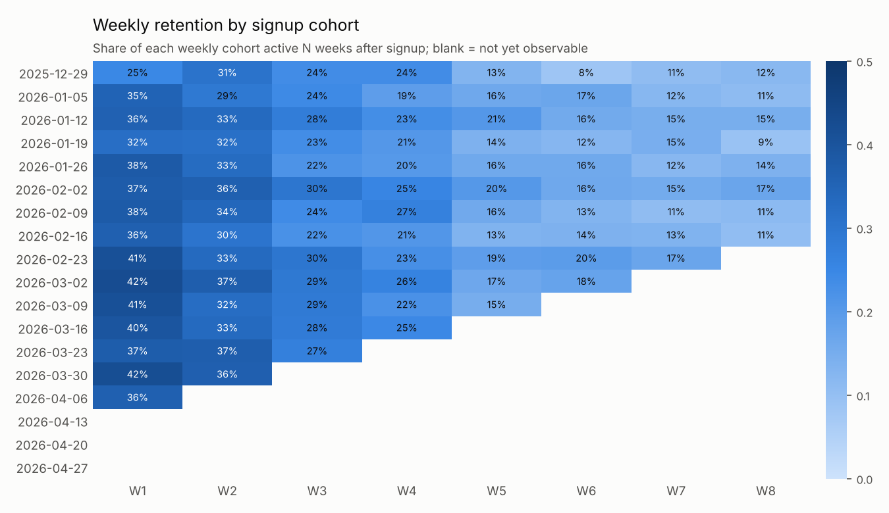
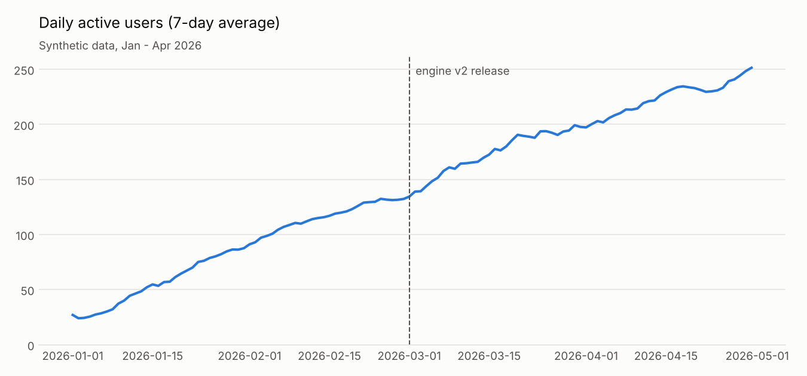
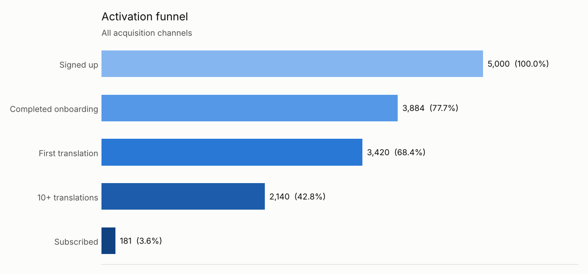
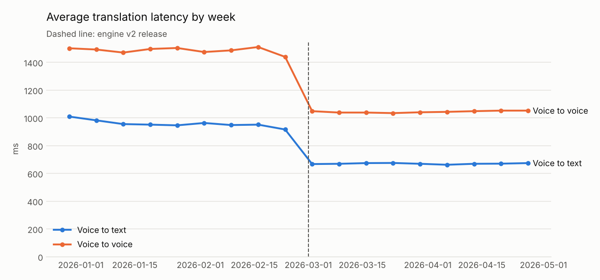
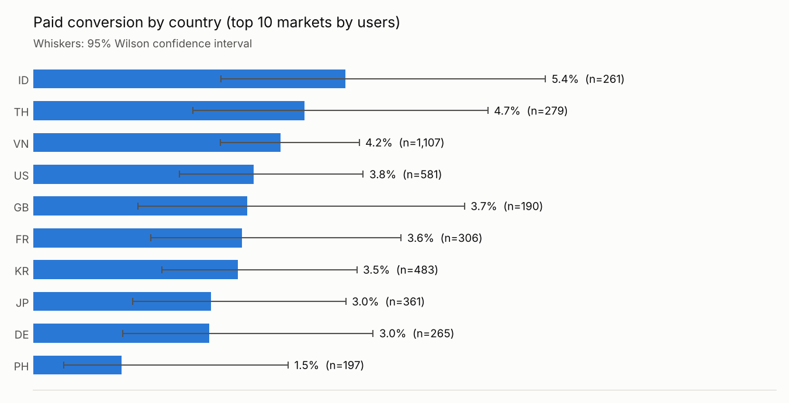

# Voice Translation Product Analytics

An end-to-end product analytics case study for **TalkBridge**, a *fictional*
real-time voice translation app. The project shows how I approach product
questions as a product manager: define the metrics, model the data in SQL,
test the pipeline in Python, and hand the results to a Power BI dashboard.

> **About the data.** Every number in this repository comes from a synthetic
> dataset generated by `src/generate_data.py` (seed 42). It does not use, and
> does not describe, any real company, client, product or user.



## Product questions

1. **Engagement** - How many people use the app each day, and how "sticky" is it?
2. **Retention** - What share of each signup cohort is still active after N weeks?
3. **Activation** - Where do new users drop off between signup and payment, and
   which acquisition channel brings the best users?
4. **Release impact** - Did the (fictional) engine v2 release on 2026-03-01
   make translations faster and more reliable?
5. **Markets** - Do some countries convert to paid better than others?

## Key findings (synthetic data)

| Question | Result |
|---|---|
| Engine v2 latency | Median latency fell by about 30% for both modes (voice to text ~900 ms to ~630 ms, voice to voice ~1,400 ms to ~980 ms); the 95% bootstrap interval excludes zero |
| Engine v2 reliability | Translation success rate rose from about 93% to 96% |
| Activation | 68% of signups made a first translation and 43% reached 10+ translations, but only 3.6% subscribed; the biggest single drop is habit to payment |
| Channels | Referral users convert to paid at ~5.4% vs ~1.5% for social ads, despite social ads bringing 1.7x more signups |
| Markets | Paid conversion ranges from 1.5% (PH) to 5.4% (ID), but the 95% confidence intervals of almost all large markets overlap; with a few hundred users per country, the data cannot rank markets yet |
| Retention | Week-1 retention is ~36% for cohorts before engine v2 and ~40% after; this is an observational comparison, not an A/B test, so it suggests but does not prove a causal effect |

Full generated output: [`outputs/summary.md`](outputs/summary.md).

### Recommendations a PM could take from this

- Shift acquisition budget from social ads toward referral incentives, and track
  paid conversion per channel rather than signups alone.
- The 10+ translations to paid step is the weakest link: test a paywall or trial
  offer timed around the user's 10th translation.
- Do not prioritise markets on conversion alone yet: wait for larger samples or
  run a pricing test in the 2-3 largest markets.
- Confirm the retention effect of engine v2 with a holdout or staged rollout
  before attributing growth to it.

## Charts

| | |
|---|---|
|  |  |
|  |  |

## Data model

```
users (1) ──< sessions (1) ──< translations
  │
  └──< subscriptions                releases (reference table)
```

| Table | Description |
|---|---|
| `users` | signup date, country, platform, acquisition channel, onboarding status |
| `sessions` | session start time and duration |
| `translations` | mode (voice to text / voice to voice), language pair, latency, success |
| `subscriptions` | plan (monthly / annual) and price |
| `releases` | engine versions and release dates |

## Project structure

```
├── src/
│   ├── generate_data.py    # synthetic data -> data/raw/*.csv + data/talkbridge.db (SQLite)
│   └── analyze.py          # runs SQL, bootstrap statistics, exports tables and charts
├── sql/                    # one file per analysis, readable on its own
│   ├── 01_daily_active_users.sql
│   ├── 02_weekly_retention_cohorts.sql
│   ├── 03_activation_funnel.sql
│   ├── 04_feature_usage.sql
│   ├── 05_language_pairs.sql
│   └── 06_country_breakdown.sql
├── outputs/
│   ├── tables/             # Power BI-ready CSV tables
│   ├── charts/             # PNG charts used in this README
│   └── summary.md          # generated findings
├── powerbi/                # how to rebuild the dashboard + DAX measures
└── tests/                  # pytest checks on data integrity and metric logic
```

## How to run

Requires Python 3.10+.

```bash
python -m venv .venv
source .venv/bin/activate          # Windows: .venv\Scripts\activate
pip install -r requirements.txt

python src/generate_data.py        # about 2 seconds
python src/analyze.py
python -m pytest -q
```

Or with `make`: `make all`.

## Methods and caveats

- **Active user**: a user with at least one session on that day. WAU and MAU use
  rolling 7 and 30 day windows.
- **Retention**: share of a weekly signup cohort with a session in week N after
  their own signup date. Weeks that have not fully elapsed are flagged
  (`is_complete_week`) and left blank in the heatmap, so recent cohorts are not
  mistaken for churn.
- **Latency impact**: relative change in median latency with a 2,000-sample
  bootstrap confidence interval. Medians are used because latency is right-skewed.
- **Country conversion**: 95% Wilson score intervals, which behave better than
  the normal approximation when rates are small and samples are a few hundred.
- **Funnel**: counts users who ever reached each step. Recent signups have had
  less time to reach later steps, so late-funnel rates are a lower bound.

## Tech stack

Python (pandas, NumPy, Matplotlib), SQL (SQLite), Power BI / DAX, pytest.

## License

MIT
